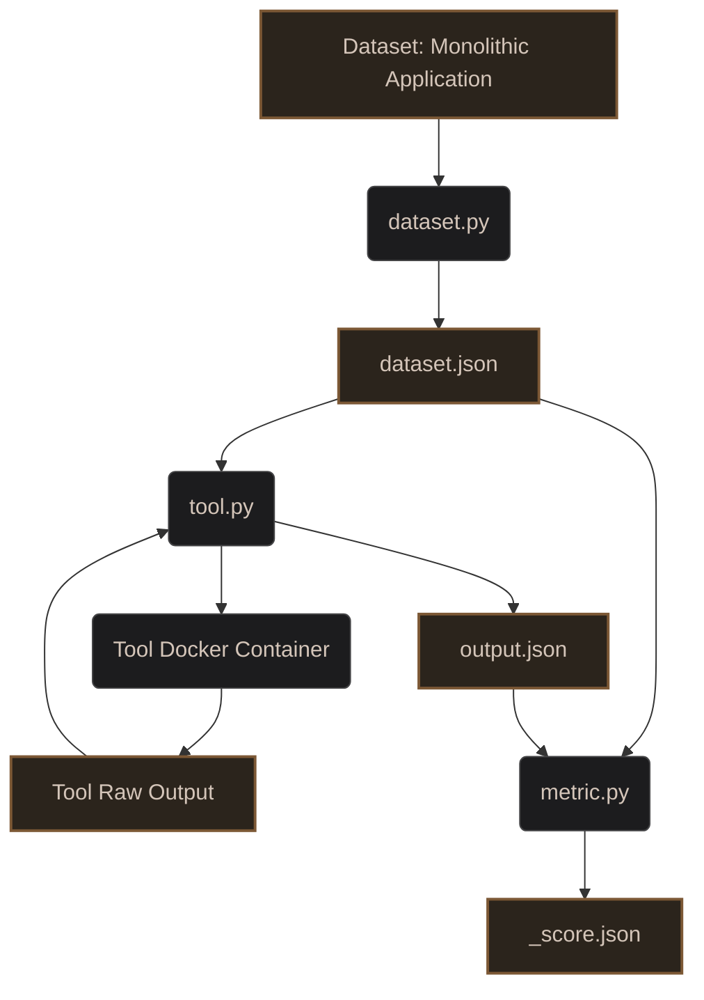

# Automatic Microservice Decomposition using Improved Code Embedding

Welcome to the repository for evaluating the state-of-the-art (SOTA) in Microservice Decomposition. This work is part of our Final Year Project (FYP): **"Automatic Microservice Decomposition using Improved Code Embedding"**.

## Project Motivation
Migrating monolithic applications to microservices is a complex challenge. Many automated decomposition tools have been proposed in literature. The goal of this repository is to systematically evaluate these tools across three dimensions:
1. **Methods/Tools:** The algorithmic approaches used to decompose monoliths.
2. **Datasets:** The monolithic application codebases used as input.
3. **Metrics:** The quantitative evaluation metrics to measure the quality of the resulting microservices.

## Methodology
To ensure reproducible, fair, and scalable evaluations, we adopt the following methodology:
- **Datasets & Ground Truth:** Open-source monolithic and microservice applications are tracked as **Git Submodules**. We use a unified `dataset.py` script to extract standard representations (e.g. `dataset.json`).
- **Tools (Methods):** Decomposition tools are integrated via a unified `tool.py` orchestrator. This script dynamically builds/runs the tool via **Docker** and converts the tool's raw output into a standard `output.json`.
- **Metrics:** Our evaluation pipeline relies on specific metric evaluators (e.g., `metric.py` inside `metrics/<metric>/`). These scripts ingest `dataset.json` and `output.json` to produce a final `<metric>_score.json`.

## Architecture Pipeline

The evaluation pipeline utilizes specialized scripts to standardize datasets and tool inputs/outputs.



## Current Candidates

### Tools (Methods)
* **[MAGNET](https://github.com/magnetmicro/MAGNET)** - `tools/magnet/`

### Datasets (Monoliths)
* **[Acme Air](https://github.com/acmeair/acmeair)** - `datasets/acme-air/`

### Metrics
* **CHM (Cohesion at Message level)** - `metrics/chm/`

## Repository Structure

```text
fyp-sota/
├── datasets/
│   └── <dataset>/         # Git submodule + dataset.py + generated dataset.json
├── tools/
│   └── <tool>/            # Git submodule + tool.py (orchestrator) + Dockerfile
├── metrics/
│   └── <metric>/          # metric.py script to calculate scores
├── README.md
```

## Adding a New Tool

To evaluate a new decomposition tool, follow this standard procedure:

1. **Create a Wrapper Directory:** Create a new folder under `tools/` (e.g., `tools/<new-tool>/`).
2. **Add as Submodule:** Inside your wrapper directory, add the tool's source code as a submodule.
3. **Dockerize:** Create a `Dockerfile` in `tools/<new-tool>/` that installs all required dependencies for the tool.
4. **Create the Orchestrator:** Write a `tool.py` script that takes `--dataset-path` and `--output-path`. It should:
   - Read `dataset.json` for paths.
   - Execute the Docker container.
   - Parse the raw results into `output.json`.

## Adding a New Dataset

To add a new monolithic application for evaluation, follow this procedure:

1. **Create a Wrapper Directory:** Create a new folder under `datasets/` (e.g., `datasets/<new-dataset>/`).
2. **Add as Submodule:** Add the monolith's source code as a submodule.
3. **Create the Adapter:** Write a `dataset.py` script that extracts the generic dependency structure from the codebase and saves it as `dataset.json`.

## Setup and Usage

### Prerequisites
- [Git](https://git-scm.com/)
- [Docker](https://docs.docker.com/get-docker/)
- [uv](https://github.com/astral-sh/uv) (for ultra-fast Python dependency management)

### 1. Cloning the Repository
Since datasets and tools are managed as submodules, ensure you clone them recursively:
```bash
git clone --recursive https://github.com/your-username/fyp-sota.git
cd fyp-sota
```

### 2. End-to-End Pipeline Execution

**Step 2a: Prepare Dataset**
```bash
cd datasets/acme-air
uv run dataset.py
```

**Step 2b: Run Tool**
```bash
cd ../../tools/magnet
uv run tool.py \
  --dataset-path ../../datasets/acme-air \
  --output-path ./outputs/acme-air
```

**Step 2c: Evaluate Metric**
```bash
cd ../../metrics/chm
uv run metric.py \
  --dataset-path ../../datasets/acme-air \
  --output-path ../../tools/magnet/outputs/acme-air
```
