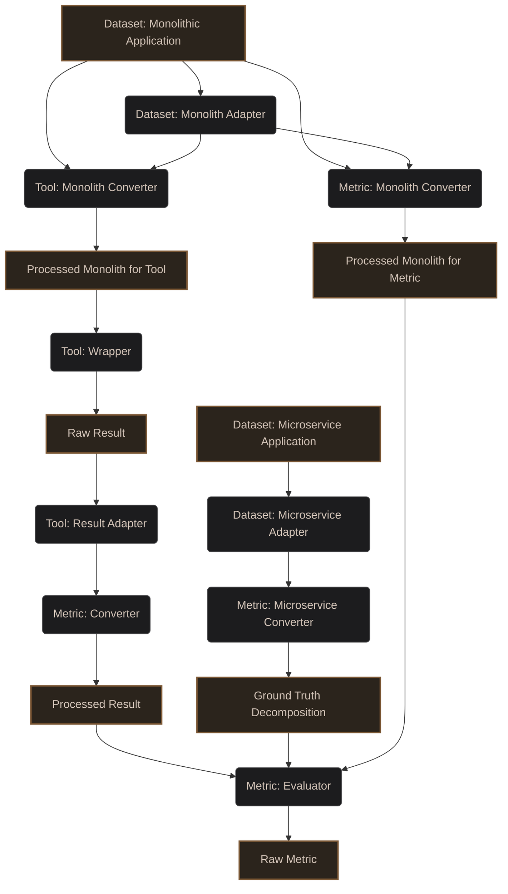

# Automatic Microservice Decomposition using Improved Code Embedding

Welcome to the repository for evaluating the state-of-the-art (SOTA) in Microservice Decomposition. This work is part of our Final Year Project (FYP): **"Automatic Microservice Decomposition using Improved Code Embedding"**.

## Project Motivation
Migrating monolithic applications to microservices is a complex challenge. Many automated decomposition tools have been proposed in literature. The goal of this repository is to systematically evaluate these tools across three dimensions:
1. **Methods/Tools:** The algorithmic approaches used to decompose monoliths.
2. **Datasets:** The monolithic application codebases used as input.
3. **Metrics:** The quantitative evaluation metrics to measure the quality of the resulting microservices.

## Methodology
To ensure reproducible, fair, and scalable evaluations, we adopt the following methodology:
- **Datasets & Ground Truth:** Open-source monolithic and microservice applications are tracked as **Git Submodules**. We use `Dataset: Monolith Adapter` and `Dataset: Microservice Adapter` scripts (located in `datasets/`) to extract standard representations.
- **Tools (Methods):** Decomposition tools are containerized via **Docker**. A `Tool: Monolith Converter` prepares the `Processed Monolith for Tool` needed by the tool wrapper. Once the `Tool: Wrapper` generates a `Raw Result`, a `Tool: Result Adapter` converts this into a universal tool-agnostic format.
- **Metrics:** Our evaluation pipeline relies on a universal `Metric: Evaluator`. Metric-specific `Metric: Converter` scripts (located in `metrics/`) ingest the universal tool output and produce a `Processed Result` tailored for that specific metric. Similarly, inputs like the monolith structure or the ground truth are prepared by `Metric: Monolith Converter` and `Metric: Microservice Converter`.

## Architecture Pipeline

The evaluation pipeline utilizes specialized adapters to standardize datasets and tool inputs/outputs. This abstraction allows for seamless integration of new monolithic datasets, microservice ground truths, and evaluation tools.



## Current Candidates

### Tools (Methods)
* **[MAGNET](https://github.com/magnetmicro/MAGNET)** - `tools/magnet/`

### Datasets (Monoliths)

### Metrics

## Repository Structure

```text
fyp-sota/
├── datasets/     # Dataset Git Submodules, plus 'Dataset: Monolith Adapter' and 'Dataset: Microservice Adapter' scripts
├── tools/        # Tool submodules, plus 'Tool: Monolith Converter', 'Tool: Wrapper', and 'Tool: Result Adapter' scripts
├── metrics/      # Universal 'Metric: Evaluator' and all 'Metric: ... Converter' scripts
├── results/      # Generated decomposition outputs and final evaluation metrics
├── scripts/      # Global automation scripts for orchestrating the pipeline
└── README.md
```

## Adding a New Tool

To evaluate a new decomposition tool, follow this standard procedure:

1. **Create a Wrapper Directory:** Create a new folder under `tools/` (e.g., `tools/<new-tool>/`).
2. **Add as Submodule:** Inside your wrapper directory, add the tool's source code as a submodule:
   ```bash
   git submodule add <tool-repo-url> tools/<new-tool>/<ToolName>
   ```
3. **Create Tool-Specific Converters & Adapters:**
   - **In `tools/<new-tool>/`**: Write a `Tool: Monolith Converter` to map the generic dataset output into the `Processed Monolith for Tool` required by your tool.
   - **In `tools/<new-tool>/`**: Write a `Tool: Result Adapter` to parse the tool's `Raw Result` into the universal intermediate format. *(Note: You do not need to write new Metric Converters; the existing ones in `metrics/` will automatically process your adapter's output!)*
4. **Dockerize:** Create a `Dockerfile` in `tools/<new-tool>/` that installs all required dependencies and sets up an entrypoint to run the `Tool: Wrapper` and its adapters.
5. **Document:** Add a `README.md` in `tools/<new-tool>/` documenting how to build and execute the tool.
6. **Update Main README:** Add the tool to the **Current Candidates** list in the root `README.md`.

## Adding a New Dataset

To add a new monolithic application for evaluation, follow this procedure:

1. **Create a Wrapper Directory:** Create a new folder under `datasets/` (e.g., `datasets/<new-dataset>/`).
2. **Add as Submodule:** Inside your wrapper directory, add the monolith's source code as a submodule:
   ```bash
   git submodule add <dataset-repo-url> datasets/<new-dataset>/<DatasetName>
   ```
3. **Add Ground Truth (Optional):** If a microservice ground truth exists, you can add it as another submodule within `datasets/<new-dataset>/`.
4. **Create Dataset Adapters:**
   - **In `datasets/<new-dataset>/`**: Write a `Dataset: Monolith Adapter` script to extract the generic dependency structure from the monolithic codebase.
   - **In `datasets/<new-dataset>/`**: Write a `Dataset: Microservice Adapter` (if ground truth exists) to map the ground truth into the standard microservice format.
5. **Document:** Add a `README.md` in `datasets/<new-dataset>/` documenting the dataset.
6. **Update Main README:** Add the dataset to the **Current Candidates** list in the root `README.md`.

## Setup and Usage

### Prerequisites
- [Git](https://git-scm.com/)
- [Docker](https://docs.docker.com/get-docker/) & Docker Compose
- Python 3.x (for running scripts and adapters)

### 1. Cloning the Repository
Since datasets are managed as submodules, ensure you clone them recursively:
```bash
git clone --recursive https://github.com/your-username/fyp-sota.git
cd fyp-sota
```
*(If you have already cloned the repository without submodules, run `git submodule update --init --recursive`)*

### 2. Setting up Tools
Navigate to the `tools/` directory. Each tool has its own Dockerized environment. Refer to the specific tool's `README.md` for build instructions. Generally:
```bash
cd tools/[tool-name]
docker build -t fyp-[tool-name] .
```

### 3. Evaluating a Tool
Run the wrapper script for a specific tool against a dataset. (These scripts will be located in the `scripts/` directory).
```bash
# Example placeholder
./scripts/run_tool.sh --tool [tool-name] --dataset [dataset-name] --output results/[run-id]/
```

### 4. Calculating Metrics
Use the appropriate metric adapter to evaluate the output of a specific tool:
```bash
# Example placeholder
python metrics/[tool-name]_adapter.py --input results/[run-id]/ --output results/[run-id]_metrics.json
```
