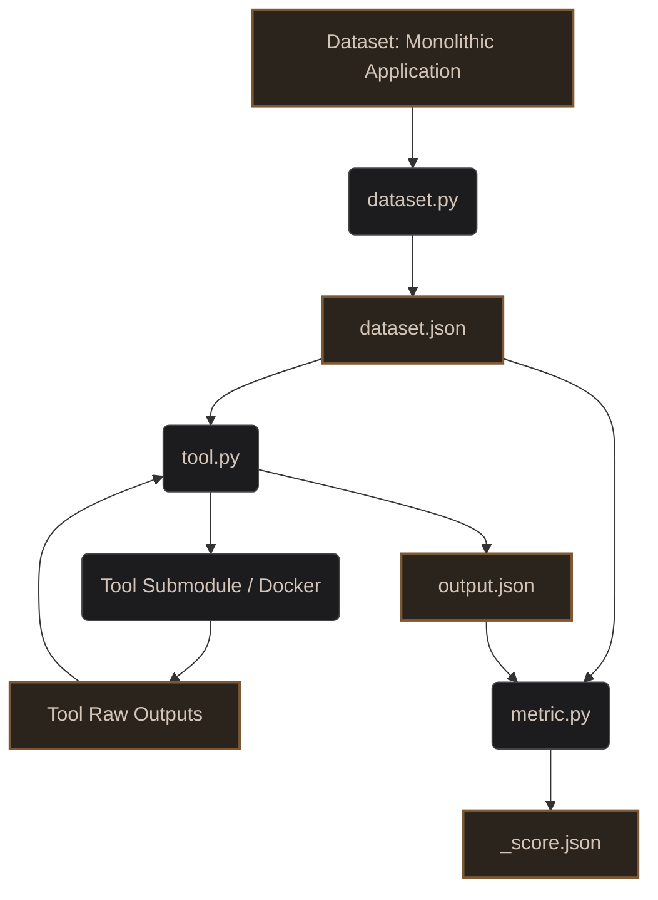

# Automatic Microservice Decomposition using Improved Code Embedding

Welcome to the repository for evaluating the state-of-the-art (SOTA) in Microservice Decomposition. This work is part of our Final Year Project (FYP): **"Automatic Microservice Decomposition using Improved Code Embedding"**.

## Project Motivation
Migrating monolithic applications to microservices is a complex challenge. Many automated decomposition tools have been proposed in literature. The goal of this repository is to systematically evaluate these tools across three dimensions:
1. **Methods/Tools:** The algorithmic approaches used to decompose monoliths.
2. **Datasets:** The monolithic application codebases used as input.
3. **Metrics:** The quantitative evaluation metrics to measure the quality of the resulting microservices.

## Methodology & Common JSON Schemas
To ensure reproducible, fair, and scalable evaluations, we adopt the following methodology based on three standard JSON formats:

### 1. Datasets & `dataset.json`
- Linking an external git repo (if any) as a submodule is **preferred** instead of copying files.
- A `dataset.py` script is **mandatory** and must produce a `dataset.json`. Adding other scripts to run and additional instructions must be put in the `README.md` for that specific dataset.
- `dataset.py` uses the shared JavaParser extractor (`datasets/extractor/`, JDK 17 + Maven, built on first run) and fails loudly if
  any source file does not parse. `dataset.json` is method-level and also lists every class (`classes`) and class-level edges
  (`CALL`, `EXTENDS`, `IMPLEMENTS`, `FIELD`, `weight` = number of occurrences). Optional per-dataset inputs sit next to it:
  `entrypoints.txt` (web entrypoint classes, used by CHGNN/AE-K/VAE-C) and `fosci_trace.csv.gz` (FoSCI execution trace).
- **Schema**:
  ```json
  {
    "dataset": "Dataset Name",
    "source_path": "path/to/source",
    "build_path": "path/to/target/monolith.jar",
    "xmi_path": "path/to/kdm.xmi",
    "methods": {
      "com.example.Class.method": {
        "id": "com.example.Class.method",
        "return_type": "void",
        "parameters": ["int", "String"]
      }
    }
  }
  ```

### 2. Tools & `output.json`
- Using Git submodules and Dockerizing the tools is **preferred, but not mandatory**. 
- If a tool requires additional dataset metadata, the schema for `dataset.json` must be extended/changed to accommodate it.
- A `tool.py` script is **mandatory** and must take exactly 2 parameters (`--dataset-path`, `--output-path`) to produce a mandatory `output.json`. Raw tool outputs should also be saved in the output directory.
- **Schema**:
  ```json
  {
    "tool": "Tool Name",
    "microservices": {
      "microservice_1": [
        "com.example.Class.method1",
        "com.example.Class.method2"
      ]
    }
  }
  ```

A tool may emit class FQNs or method ids in `microservices`. `metrics/partition.py` resolves both: method ids roll up to their
class by majority vote, classes explode to all their methods. Ids that match nothing in `dataset.json` are counted, never guessed,
and every `*_score.json` carries a `coverage` block (`classes`, `assigned`, `unassigned`, `unmatched_ids`, `conflicts`).

### 3. Metrics & `<metric>_score.json`
- A `metric.py` script is **mandatory** and takes exactly 2 parameters (`--dataset-path`, `--output-path`) to generate `<metric>_score.json` inside the tool's output directory.
- **Schema**:
  ```json
  {
    "metric": "Metric Name",
    "score": 0.85,
    "microservice_scores": {
      "microservice_1": 0.9,
      "microservice_2": 0.8
    }
  }
  ```

## Architecture Pipeline

The evaluation pipeline utilizes specialized scripts to standardize datasets and tool inputs/outputs.



## Current Candidates

### Tools (Methods)
* **[MAGNET](https://github.com/magnetmicro/MAGNET)** - `tools/magnet/`
* **[IBM Mono2Micro](https://www.ibm.com/cloud/mono2micro)** - `tools/mono2micro/`
* **Triplet-Guided CHGNN** - `tools/triplet-guided-chgnn/`
* **[CHGNN](https://github.com/Alex-Mathai-98/Monolith-to-Microservices)** (original, IJCAI 2022) - `tools/chgnn/`
* **[CoGCN](https://github.com/utkd/cogcn)** (AAAI 2021) - `tools/cogcn/`
* **[FoSCI](https://github.com/wj86/FoSCI)** (execution-trace based, TSE 2019) - `tools/fosci/`
* **[CARGO](https://github.com/vikramnitin9/tackle-data-gravity-insights)** (ASE 2022) - `tools/cargo/`
* **AE-K** baseline (autoencoder + KMeans) - `tools/ae-k/`
* **VAE-C** (variational autoencoder + fuzzy c-means) - `tools/vae-c/`

The last six moved here from the retired `fyp-benchmarking` repository, which this repository supersedes. Each tool's README
says what it needs and which datasets are N/A for it.

#### Tool x dataset applicability

| Dataset | CHGNN | CoGCN | AE-K / VAE-C | FoSCI | CARGO |
| :--- | :--- | :--- | :--- | :--- | :--- |
| acme-air, apache-roller, autocare, bear-board, jforum, jpetstore, pharmacy, spring-blog, spring-petclinic | config in `tools/chgnn/configs/` | yes | yes (`entrypoints.txt`) | trace (authors' or `fosci_trace.csv.gz`) | needs cached Doop facts |
| daytrader, plants | authors' bundled inputs | yes | yes | N/A (1 functional atom) | needs cached Doop facts |
| javafx-pos | N/A (no web entrypoints) | yes | N/A | N/A | needs cached Doop facts |
| genapp (COBOL) | N/A | N/A | N/A | N/A | N/A |

An N/A cell is still written: `output.json` is `{"error": "...", "tool": "..."}` and the metrics refuse to score it.

### Datasets (Monoliths)
* **[Acme Air](https://github.com/acmeair/acmeair)** - `datasets/acme-air/`
* **[Spring PetClinic](https://github.com/spring-projects/spring-petclinic)** - `datasets/spring-petclinic/`
* **[Plants by WebSphere](https://github.com/WASdev/sample.plantsbywebsphere)** - `datasets/plants/`
* **[JPetStore](https://github.com/mybatis/jpetstore-6)** - `datasets/jpetstore/`
* **[DayTrader](https://github.com/WASdev/sample.daytrader7)** - `datasets/daytrader/`
* **[JForum](https://github.com/jforum/jakartaEE)** - `datasets/jforum/`
* **[JavaFX Point of Sales](https://github.com/sadatrafsanjani/JavaFX-Point-of-Sales)** - `datasets/javafx-pos/`
* **[SpringBlog](https://github.com/Raysmond/SpringBlog)** - `datasets/spring-blog/`
* **[Apache Roller](https://github.com/apache/roller)** - `datasets/apache-roller/`
* **[Bear Board](https://github.com/rokinmaharjan/bear-board)** - `datasets/bear-board/`
* **[CICS Genapp](https://github.com/cicsdev/cics-genapp)** - `datasets/genapp/`
* **[Pharmacy](https://github.com/rokinmaharjan/pharmacy)** - `datasets/pharmacy/`
* **[AutoCare Nepal](https://github.com/rokinmaharjan/autocare-nepal)** - `datasets/autocare/`

### Metrics
* **CHM (Cohesion at Message level)** - `metrics/chm/`
* **CHD (Cohesion at Domain level)** - `metrics/chd/`
* **SM (Structural Modularity)** - `metrics/sm/`
* **ICP (Inter-Call Percentage)** - `metrics/icp/`
* **IFN (Interface Number)** - `metrics/ifn/`
* **NED (Non-Extreme Distribution)** - `metrics/ned/`
* **BCP (Business Context Purity)** - `metrics/bcp/`
* **Unified Metrics Runner** - `metrics/compute_all.py`

## Repository Structure

```text
fyp-sota/
├── datasets/
│   ├── common.py, extractor/        # shared JavaParser extraction
│   └── <dataset>/
│       ├── README.md
│       ├── dataset.py
│       ├── dataset.json
│       ├── entrypoints.txt          # optional
│       └── fosci_trace.csv.gz       # optional
├── tools/
│   ├── _common/                     # code shared by ae-k and vae-c
│   └── <tool>/
│       ├── README.md
│       ├── tool.py
│       └── outputs/
│           └── <dataset>/
│               ├── output.json
│               ├── raw_files...
│               └── <metric>_score.json 
├── metrics/
│   ├── partition.py, compute_all.py
│   └── <metric>/
│       ├── README.md
│       └── metric.py
├── scripts/
│   ├── benchmark.py                 # central CLI: `run` every cell, `report` the tables
│   └── run_sweep.py                 # one cell: repeated runs + mean metrics
├── tests/                           # see "Tests"
└── README.md
```

## Adding a New Tool

1. **Create Directory:** Create a new folder under `tools/` (e.g., `tools/<new-tool>/`).
2. **Add Source (Preferred):** Add the tool as a submodule and create a `Dockerfile`.
3. **Create the Orchestrator (Mandatory):** Write a `tool.py` script that takes exactly `--dataset-path` and `--output-path`. It should:
   - Read `dataset.json` for dataset structure/paths. (Update `dataset.json` schema if the tool needs more data).
   - Execute the tool (via Docker or locally).
   - Parse the raw results into `output.json` inside `--output-path`.
   - Save any raw outputs to `--output-path` as well.

## Adding a New Dataset

1. **Create Directory:** Create a new folder under `datasets/` (e.g., `datasets/<new-dataset>/`).
2. **Add Source (Preferred):** Add the monolith's source code as a submodule instead of copying files.
3. **Create the Adapter (Mandatory):** Write a `dataset.py` script that extracts the generic dependency structure and saves it as `dataset.json`.
4. **Documentation:** Any additional scripts or instructions required to extract the `dataset.json` (like generating an XMI) must be put in the dataset's `README.md`.

## Setup and Usage

### Prerequisites
- [Git](https://git-scm.com/)
- [Docker](https://docs.docker.com/get-docker/) (Preferred for most tools)
- [uv](https://github.com/astral-sh/uv) (For Python dependency management)

### 1. Cloning the Repository
```bash
git clone git@github.com:EmbedFlow-MicroserviceDecomposition/sota-benchmarking.git
cd sota-benchmarking
GIT_LFS_SKIP_SMUDGE=1 git submodule update --init   # not --recursive, see below
```

Do not use `--recursive`: CARGO's upstream repository contains a broken nested submodule entry
(`RQ2/daytrader_apps/daytrader_mono2micro`, no URL), so a recursive update fails on it, and none of our submodules needs its nested
ones. `GIT_LFS_SKIP_SMUDGE=1` keeps the FoSCI submodule from downloading about 1 GB of traces; pull the four the authors' FoSCI cells need
(`cd tools/fosci/FoSCI && git lfs pull --include="traces/jpetstore.txt,traces/springblog.txt,traces/jforum.txt,traces/roller.txt"`, about 620 MB; needs `git-lfs` installed). The submodule URLs are SSH
(`git@github.com:...`), so the machine needs an SSH key registered with GitHub.

### 2. End-to-End Pipeline Execution

**Step 2a: Prepare Dataset**
```bash
cd datasets/acme-air
uv run dataset.py
```

**Step 2b: Run Tool**
```bash
cd ../../tools/magnet
uv run tool.py \
  --dataset-path ../../datasets/acme-air \
  --output-path ./outputs/acme-air
```

**Step 2c: Evaluate Metric**
```bash
cd ../../metrics/chm
uv run metric.py \
  --dataset-path ../../datasets/acme-air \
  --output-path ../../tools/magnet/outputs/acme-air
```

## Running the whole benchmark

`scripts/benchmark.py` is the central CLI. Prerequisites: Docker running, JDK 17 + Maven (the extractor builds on first use), `uv`,
`git submodule update --init` (without `--recursive`, see step 1), the four FoSCI LFS traces (JPetStore, Spring Blog, JForum, Roller)
(`cd tools/fosci/FoSCI && git lfs pull --include="traces/jpetstore.txt,traces/springblog.txt,traces/jforum.txt,traces/roller.txt"`), and CARGO's Doop facts in
`tools/cargo/doop-data/` (see `tools/cargo/README.md`).

```bash
uv run scripts/benchmark.py run --dry-run          # the plan: which cells exist, which would run
uv run scripts/benchmark.py run                    # every missing cell with the paper run counts (many hours)
uv run scripts/benchmark.py run --tools chgnn,fosci --datasets jpetstore,bear-board --profile quick   # one run per cell
uv run scripts/benchmark.py report                 # SM, ICP, IFN, NED, BCP, CHM, CHD: one table per metric, datasets x tools
uv run scripts/benchmark.py report --metrics SM,NED --coverage --format markdown
```

Results are generated, not committed: `tools/<tool>/outputs/` is git-ignored, so a fresh clone has no tables until `run` has produced
cells (or they are copied over from another machine).

`run` builds a missing `dataset.json`, skips cells that already have results or a deliberate N/A (`--force` redoes them), tries again
any cell whose every run failed for a real reason such as a missing input or Docker being down, and runs the cells one after another. `report` only reads files, so it can run while `run` is still going; it also shows the older
single-run cells (Triplet-Guided CHGNN, MAGNET, Mono2Micro) if they have outputs. `N/A` marks a cell that does not apply to a tool,
`FAIL` a cell where every run failed. The paper profile uses: CHGNN 10 runs, CoGCN 5, AE-K 3, VAE-C 3 (5 on bear-board, pharmacy,
autocare), FoSCI 5 (1 on Roller), CARGO 1 invocation (its 30-entry K x seed grid runs inside).

## Tests

```bash
uv run --python 3.12 --with pytest --with numpy==2.4.4 --with scipy==1.18.0 --with scikit-learn==1.9.0 \
  --with scikit-fuzzy==0.5.0 --with tensorflow==2.21.0 pytest tests -q
```

Without the extra `--with` packages only `tests/test_vaec_core.py` skips. The FoSCI end-to-end test runs the real search (~90 s). The
extractor has its own JUnit suite: `mvn -f datasets/extractor/pom.xml test`.
