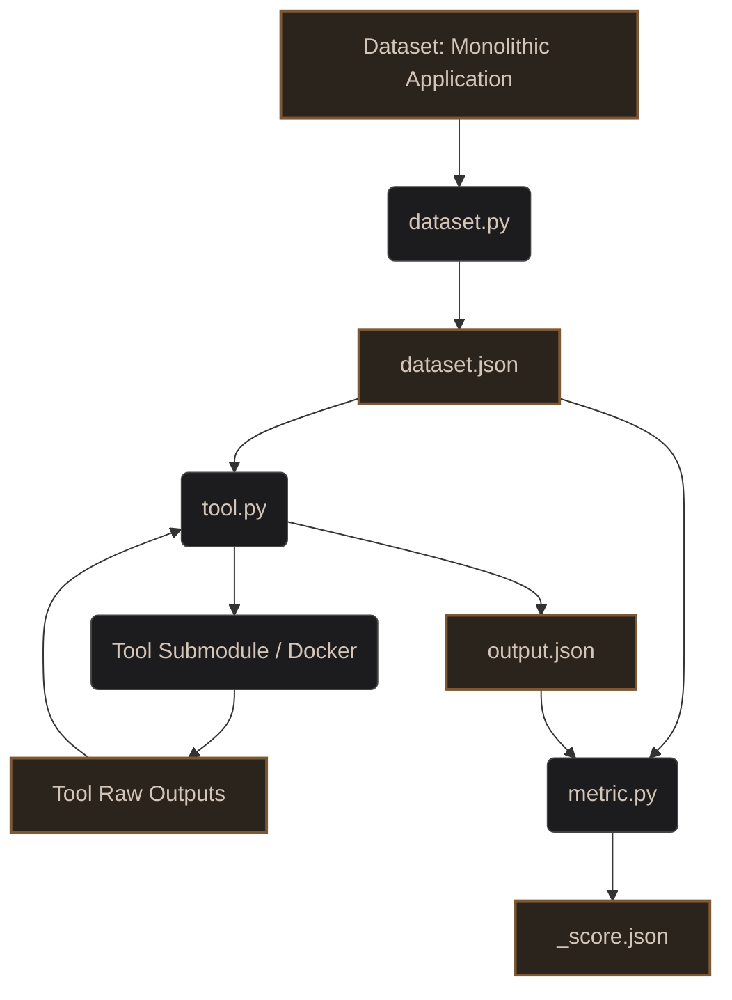

# Automatic Microservice Decomposition using Improved Code Embedding

Welcome to the repository for evaluating the state-of-the-art (SOTA) in Microservice Decomposition. This work is part of our Final Year Project (FYP): **"Automatic Microservice Decomposition using Improved Code Embedding"**.

## Project Motivation
Migrating monolithic applications to microservices is a complex challenge. Many automated decomposition tools have been proposed in literature. The goal of this repository is to systematically evaluate these tools across three dimensions:
1. **Methods/Tools:** The algorithmic approaches used to decompose monoliths.
2. **Datasets:** The monolithic application codebases used as input.
3. **Metrics:** The quantitative evaluation metrics to measure the quality of the resulting microservices.

## Methodology & Common JSON Schemas
To ensure reproducible, fair, and scalable evaluations, we adopt the following methodology based on three standard JSON formats:

### 1. Datasets & `dataset.json`
- Linking an external git repo (if any) as a submodule is **preferred** instead of copying files.
- A `dataset.py` script is **mandatory** and must produce a `dataset.json`. Adding other scripts to run and additional instructions must be put in the `README.md` for that specific dataset.
- **Schema**:
  ```json
  {
    "dataset": "Dataset Name",
    "source_path": "path/to/source",
    "xmi_path": "path/to/kdm.xmi",
    "methods": {
      "com.example.Class.method": {
        "id": "com.example.Class.method",
        "return_type": "void",
        "parameters": ["int", "String"]
      }
    }
  }
  ```

### 2. Tools & `output.json`
- Using Git submodules and Dockerizing the tools is **preferred, but not mandatory**. 
- If a tool requires additional dataset metadata, the schema for `dataset.json` must be extended/changed to accommodate it.
- A `tool.py` script is **mandatory** and must take exactly 2 parameters (`--dataset-path`, `--output-path`) to produce a mandatory `output.json`. Raw tool outputs should also be saved in the output directory.
- **Schema**:
  ```json
  {
    "tool": "Tool Name",
    "microservices": {
      "microservice_1": [
        "com.example.Class.method1",
        "com.example.Class.method2"
      ]
    }
  }
  ```

### 3. Metrics & `<metric>_score.json`
- A `metric.py` script is **mandatory** and takes exactly 2 parameters (`--dataset-path`, `--output-path`) to generate `<metric>_score.json` inside the tool's output directory.
- **Schema**:
  ```json
  {
    "metric": "Metric Name",
    "score": 0.85,
    "microservice_scores": {
      "microservice_1": 0.9,
      "microservice_2": 0.8
    }
  }
  ```

## Architecture Pipeline

The evaluation pipeline utilizes specialized scripts to standardize datasets and tool inputs/outputs.



## Current Candidates

### Tools (Methods)
* **[MAGNET](https://github.com/magnetmicro/MAGNET)** - `tools/magnet/`

### Datasets (Monoliths)
* **[Acme Air](https://github.com/acmeair/acmeair)** - `datasets/acme-air/`
* **[Spring PetClinic](https://github.com/spring-projects/spring-petclinic)** - `datasets/spring-petclinic/`
* **[Plants by WebSphere](https://github.com/WASdev/sample.plantsbywebsphere)** - `datasets/plants/`
* **[JPetStore](https://github.com/mybatis/jpetstore-6)** - `datasets/jpetstore/`
* **[DayTrader](https://github.com/WASdev/sample.daytrader7)** - `datasets/daytrader/`
* **[JForum](https://github.com/jforum/jakartaEE)** - `datasets/jforum/`

### Metrics
* **CHM (Cohesion at Message level)** - `metrics/chm/`

## Repository Structure

```text
fyp-sota/
├── datasets/
│   └── <dataset>/
│       ├── README.md
│       ├── dataset.py
│       └── dataset.json
├── tools/
│   └── <tool>/
│       ├── README.md
│       ├── tool.py
│       └── outputs/
│           └── <dataset>/
│               ├── output.json
│               ├── raw_files...
│               └── <metric>_score.json 
├── metrics/
│   └── <metric>/
│       ├── README.md
│       └── metric.py
└── README.md
```

## Adding a New Tool

1. **Create Directory:** Create a new folder under `tools/` (e.g., `tools/<new-tool>/`).
2. **Add Source (Preferred):** Add the tool as a submodule and create a `Dockerfile`.
3. **Create the Orchestrator (Mandatory):** Write a `tool.py` script that takes exactly `--dataset-path` and `--output-path`. It should:
   - Read `dataset.json` for dataset structure/paths. (Update `dataset.json` schema if the tool needs more data).
   - Execute the tool (via Docker or locally).
   - Parse the raw results into `output.json` inside `--output-path`.
   - Save any raw outputs to `--output-path` as well.

## Adding a New Dataset

1. **Create Directory:** Create a new folder under `datasets/` (e.g., `datasets/<new-dataset>/`).
2. **Add Source (Preferred):** Add the monolith's source code as a submodule instead of copying files.
3. **Create the Adapter (Mandatory):** Write a `dataset.py` script that extracts the generic dependency structure and saves it as `dataset.json`.
4. **Documentation:** Any additional scripts or instructions required to extract the `dataset.json` (like generating an XMI) must be put in the dataset's `README.md`.

## Setup and Usage

### Prerequisites
- [Git](https://git-scm.com/)
- [Docker](https://docs.docker.com/get-docker/) (Preferred for most tools)
- [uv](https://github.com/astral-sh/uv) (For Python dependency management)

### 1. Cloning the Repository
```bash
git clone --recursive https://github.com/your-username/fyp-sota.git
cd fyp-sota
```

### 2. End-to-End Pipeline Execution

**Step 2a: Prepare Dataset**
```bash
cd datasets/acme-air
uv run dataset.py
```

**Step 2b: Run Tool**
```bash
cd ../../tools/magnet
uv run tool.py \
  --dataset-path ../../datasets/acme-air \
  --output-path ./outputs/acme-air
```

**Step 2c: Evaluate Metric**
```bash
cd ../../metrics/chm
uv run metric.py \
  --dataset-path ../../datasets/acme-air \
  --output-path ../../tools/magnet/outputs/acme-air
```
